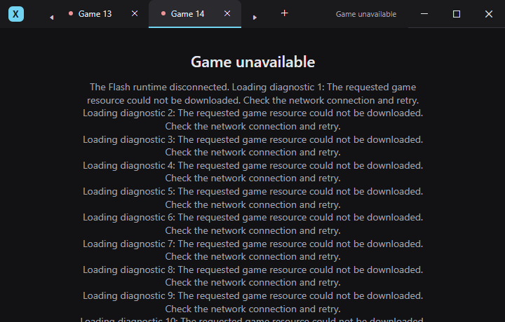
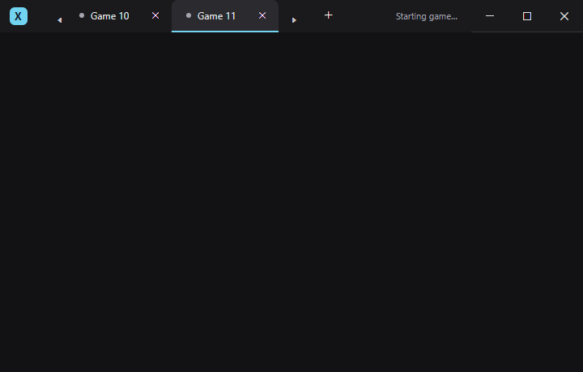

# UI interaction and styling review

Reviewed 2026-10-23 at `f2eb0af` (`feat(shell): add multi-game tabs and shared window chrome`). Application code was not changed during the original review. The findings below describe that snapshot; the implementation follow-up records their subsequent resolutions. The earlier [UI review](UI-REVIEW.md) remains a historical milestone-one assessment and future-toolbar discussion.

The review found **nine issues: one P1, six P2, and two P3**. The original automated suites passed without covering these failure cases. P1 means a UI hang needing prompt correction; P2 means broken interaction, recovery, or accessibility; P3 means a lower-impact visual or shared-style inconsistency.

## Implementation follow-up — 2026-10-23

All nine findings have been addressed, together with the five improvements selected by the user. The original evidence/recommendations are retained below for context.

| Requirement | Resolution | Current regression evidence |
| --- | --- | --- |
| Finding 1: empty-window hang | Guarded cycling over the app collection replaces the inherited handlers. | Both directions with zero/one tabs finish in a separate worker with a 15-second deadline. |
| Finding 2: keyboard close | Ctrl+F4 requests confirmation for the selected view model. | Headless and native keyboard close/cancel checks; focused Enter/Space confirmation; existing Escape coverage. |
| Finding 3: skipped overflow tabs | Selection uses collection indexes and explicitly realizes/reveals the chosen tab, including after strip resizing. | Cycling visits all 11 tabs at minimum width and wraps both ways; chosen tabs remain inside the scroll viewport. |
| Finding 4: focus transfer | Keyboard navigation keeps tab focus; pointer selection restores Flash focus. Confirmation captures its caller's policy before owner reactivation; caption actions respect that policy. | Repeated switching between two real games, native maximize/restore, keyboard cancellation, then pointer selection and game-oriented cancellation. |
| Finding 5: hidden Retry | A constrained Grid reserves the action row while error details scroll. | An 18-line error at 720 × 460 leaves both recovery actions visible and scrollable details accessible. |
| Finding 6: unnamed close buttons | Explicit Close {label} names are set for realized tabs and refreshed on label changes. | Automation peers checked while cycling overflow tabs; native fixture login/logout updates the name. |
| Finding 7: missing announcements | One polite status TextBlock includes the selected label and state. Details remain readable without duplicate live regions. | Name-change events on failure/selection and native identity changes; unchanged polls do not repeat announcements. Screen-reader speech remains a manual validation limit. |
| Finding 8: arrow alignment | Both scroll hosts stretch and reserve the shared bottom indicator area. | Both arrow centers match add/close/divider alignment at overflow. |
| Finding 9: stale brushes | Direct DynamicResource setters replace the static brush aliases. | Distinct selected/hover/pressed/text/divider/accent replacements, selected silhouette updates, and restoration. |
| I01: copyable diagnostics | Selectable details and a fixed-size Copy details action copy app version, game label/client filename, status, and full error text. | Headless clipboard content/selection checks, stable Copied feedback, and readable selection colors. Windows clipboard contents are not touched by these tests. |
| I02: prominent game name | Confirmation has a separate primary, semibold game-name line. | Headless font/text checks and rendered confirmation; native confirmation identifies the correct game. |
| I03: consistent + tooltip | Tooltip and accessible name both say Open game. | Actual template button properties checked headlessly; existing native tooltip placement checks pass. |
| I09: loading indicator | A reserved 16-DIP indeterminate FAProgressRing is active only while the selected game loads. | Startup/failure/retry bindings and native Ready-state stop; reserved chrome geometry and native hit targets retained. |
| I05: matching icon | The shared window style and executable use the cyan X multi-size icon. | Nine ICO frames checked headlessly; Windows small/large icons and embedded executable icons contain the expected badge colors. |

Validation passed: Release solution build with zero warnings/errors; foundation checks; the extended headless shell suite; and the full native normal/missing-SWF workers. The final native follow-up loaded **Game4000r6.swf** at render scale **1.0**; the inventory fixture still uses the supplied Game4000r5 source snapshot. Permanent coverage is in [UiRegressionChecks.cs](../tests/VibeSkuaX.Shell.Tests/UiRegressionChecks.cs) and [NativeUiRegressionChecks.cs](../tests/VibeSkuaX.Shell.Tests/NativeUiRegressionChecks.cs), alongside the existing checks. Native results include `artifacts/shell-tests/native-ui-regressions.json`. Pinned framework versions, session ownership, and script-facing APIs are unchanged.

Retained implementation captures: [reachable recovery actions and selected details](design/ui-review-2026-10-23/long-error-fixed.png), [aligned overflow and loading indicator](design/ui-review-2026-10-23/overflow-fixed.png), and [prominent confirmation target](design/ui-review-2026-10-23/close-game-fixed.png). Their original artifact names are `long-error-fixed.png`, `tabs-overflow-fixed.png`, and `close-game-dialog.png` in `artifacts/shell-tests/`.

## Additional selected improvements — 2026-10-24

The user subsequently selected I04, I06, I07, I08, I10, and I13. All six are implemented:

- **I04:** The native Windows title follows selection, character rename, logout, and empty state.
- **I06:** Shared IsActive-based styles quiet the title/tab text and title-bar border on inactive windows. Caption feedback, geometry, and semantic state colors remain intact.
- **I07:** A failed selected game hands keyboard focus to Retry when the active game owned focus or no other control owns it. This includes Win32 focus, not only Avalonia's logical focus. Tab/menu navigation, active confirmations, and other windows retain focus. Returning from a game-oriented confirmation to a now-failed game focuses Retry; final-tab close still focuses Open game.
- **I08:** The empty state explains opening a game, logging in, and using +.
- **I10:** Tooltips separate client readiness from connection, including connected-before-identity and not-yet-polled states, without changing the retained AS3 bridge.
- **I13:** The top-right status text is replaced by a fixed Games dropdown. Its native FluentAvalonia menu lists every owner, shows full labels and textual status, marks selection, supports pointer/keyboard/Escape, and reveals overflow headers while preserving games. The selected-game details move to tooltips; the Games button retains the polite accessibility announcement.

`ShellPolishChecks.cs` covers the actual minimum-width layout, eleven owners, menu keyboard input, live background status, stable button geometry, full-name wrapping, titles, activation styling, and empty guidance. `NativeShellPolishChecks.cs` checks the actual menu above Flash, pointer/keyboard focus policies, activation of shell/auxiliary windows, and confirmation/other-window failure focus. Existing native checks additionally verify loaded/disconnected, connected-without-identity, named connection, logout, the Win32 title, and keyboard activation of focused Retry. The original optional-candidate descriptions below are historical; only **I11, I12, I14, and I15** remain unimplemented suggestions.

## Findings

### 1. P1 — Ctrl+Tab freezes the empty window

**Trigger:** Close the last game, focus the title strip's **+** button, and press Ctrl+Tab. The UI stops responding. The empty state is a supported milestone-two state, so the tab control's shortcut remains reachable with zero games.

**Evidence:** An isolated headless process showed `Tabs=0`, `SelectedIndex=-1`, and the add button focused. Sending Ctrl+Tab through Avalonia's headless keyboard API never returned. The process was terminated after 10 seconds; its marker immediately after the key input was never written. The same result occurred when invoking the matching library key binding directly.

**Cause:** The app retains the pinned library's Ctrl+Tab binding on [AccountTabs](../VibeSkuaX.App/Features/Shell/ShellWindow.axaml). In FluentAvalonia 3.1.0, `FATabView.MoveSelection` starts with original index `-1` and item count `0`. Its loop wraps the candidate to `0` each time, then increments it; it can never reach the original index. Ctrl+Shift+Tab enters the same faulty loop in the reverse direction; that direction is source-confirmed rather than separately run.

**Source:** `references/FluentAvalonia/src/FluentAvalonia/UI/Controls/TabView/FATabView.cs`, lines 1427–1454 and 1472–1485. These reference snapshots are ignored research material, not build dependencies.

**Correction:** Handle tab cycling over the app's tab collection with an explicit zero/one-item guard, replacing or intercepting the inherited bindings so the faulty handler cannot also execute. Keep the existing control and templates.

**Regression coverage needed:** Zero, one, and multiple tabs; both cycle directions; a process timeout around the zero-tab cases so a regression cannot hang the test runner.

### 2. P2 — Ctrl+F4 does not request tab close

**Trigger:** With a game tab focused, press Ctrl+F4. No confirmation appears and nothing closes, although this shortcut is installed by the tab control.

**Evidence:** Headless keyboard input left `CloseConfirmation` null. `AccountTabs.SelectedItem` was a `GameTabViewModel`.

**Cause:** The app uses a data-bound `TabItemsSource` and two-way `SelectedItem`. The pinned library's `RequestCloseCurrentTab` only handles a selected item that is itself a `FATabViewItem`; it never resolves the container for a view-model item. Pointer close works because that path supplies the actual container.

**Source:** [ShellWindow.axaml](../VibeSkuaX.App/Features/Shell/ShellWindow.axaml), lines 17–20 and 39–40; pinned `FATabView.cs`, lines 1457–1469.

**Correction:** Route the keyboard close action to the selected view model through the existing `RequestCloseTabAsync` confirmation path. Preserve confirmation, Escape, and session ownership.

**Regression coverage needed:** Ctrl+F4 from a focused data-bound tab, cancellation, confirmation, no selection, and an already-open confirmation. This finding concerns keyboard input in the Avalonia tab strip, not a promise of global shortcuts inside Flash.

### 3. P2 — Ctrl+Tab skips games outside the visible strip

**Trigger:** Open enough tabs to overflow, select the last tab, focus its header, and press Ctrl+Tab. Cycling does not reach the first game.

**Evidence:** With 11 tabs at 720 DIPs wide, headless keyboard input moved selected index **10 → 9**, instead of wrapping **10 → 0**.

**Cause:** `FATabView.MoveSelection` tests each candidate with `ContainerFromIndex`. Virtualized tabs outside the visible range have no realized container and are skipped. Selection should cycle through game owners independently of realization.

**Source:** [AccountTabs configuration](../VibeSkuaX.App/Features/Shell/ShellWindow.axaml); pinned `FATabView.cs`, lines 1427–1454, especially line 1445.

**Correction:** Cycle through the actual tab collection and let the control bring the chosen tab into view. This can share the small guarded cycling implementation needed for finding 1.

**Regression coverage needed:** Forward/backward wrap with overflowing tabs, including targets without realized containers. Verify selection and visibility of every game, not only that the add button and captions remain visible.

### 4. P2 — Keyboard selection immediately transfers focus into Flash

**Trigger:** Start with keyboard focus in the tab strip and use Ctrl+Tab between two ready games. The first selection change sends native keyboard focus into the selected Flash client, interrupting further tab-strip keyboard navigation.

**Evidence:** A native probe explicitly focused the shell HWND and first tab, then invoked the existing Ctrl+Tab key binding. Selection changed **0 → 1**; Avalonia's focused element became null and Win32 focus moved to the second Flash HWND. A subsequent native Tab message went to that HWND and left selection unchanged. This establishes the focus transfer; it was not a physical-keyboard or exhaustive Flash shortcut test.

**Cause:** Every `SelectedTab` change queues `FocusSelectedGame`, regardless of whether selection originated from keyboard navigation, pointer input, or code. The queued callback calls the WinForms ActiveX control's `Focus()`.

**Source:** [ShellWindow.axaml.cs](../VibeSkuaX.App/Features/Shell/ShellWindow.axaml.cs), lines 35–38 and 76–79; [GameSession.cs](../VibeSkuaX.App/Sessions/GameSession.cs), lines 144–148.

**Correction:** Preserve tab-strip focus while the user is navigating there. Retain game focus restoration for interactions that deliberately return to the game, such as pointer selection and dismissing confirmation. Avoid making a blanket change that regresses the existing native caption-focus fix.

**Regression coverage needed:** Repeated keyboard cycling with two ready native games; keyboard movement to close/add actions; pointer selection and confirmation cancellation still focusing the correct game.

### 5. P2 — Long failure details push Retry outside the window

**Trigger:** Display a sufficiently long runtime/load error at the supported minimum window size, 720 × 460 DIPs. The message continues below the visible content and Retry disappears.

**Evidence:** Injecting a 10-line, 1,150-character diagnostic through the production runtime-failure message path placed Retry at **Y=499**, height 32, below the 460-DIP window. Four lines fit; 18 lines placed Retry at Y=797. These were synthetic diagnostics, not a captured production network response.

**Cause:** `GameErrorPanel` is a vertically centered `StackPanel` with a width limit but no bounded scrolling region. Its children are measured with unbounded vertical space, so the wrapping message can arrange the button outside the visible area. Failure text includes unbounded exception/callback details.

**Source:** [ShellWindow.axaml](../VibeSkuaX.App/Features/Shell/ShellWindow.axaml), lines 57–61; [GameSession.cs](../VibeSkuaX.App/Sessions/GameSession.cs), failure-message construction.

**Correction:** Reserve visible space for the recovery action and give long details a height-constrained scrolling area. A selectable details control would also make diagnostics easier to share. A ScrollViewer inside the existing unbounded StackPanel without a height constraint would not solve the measurement problem.

**Regression coverage needed:** Short, long, multiline, and unbroken errors at minimum/default sizes. Assert that Retry's visible hit area stays inside the window and details remain reachable.

### 6. P2 — Tab-close buttons expose an icon code as their accessible name

**Trigger:** Inspect or navigate to an account tab's close button with assistive technology.

**Evidence:** Its actual Avalonia automation peer returned **U+E711**, the private-use close glyph, as its name. The button had no own tooltip. The parent tab's meaningful accessible name does not name its child button.

**Cause:** The app names the tab and add action, but assumes the library names the template close button. In the pinned `FATabViewItem.OnApplyTemplate`, the code that would set the close button's accessible name is commented out under a localization TODO. Avalonia's button peer falls back to the glyph content.

**Source:** [ShellWindow.axaml](../VibeSkuaX.App/Features/Shell/ShellWindow.axaml), lines 39–40; pinned `FATabViewItem.cs`, lines 95–104; `TabViewItemStyles.axaml`, lines 266–269.

**Correction:** Give each realized close button a meaningful accessible action name, ideally including the current game label, and update it when the character label changes. Cover recycled/new containers without replacing the library template.

**Regression coverage needed:** Inspect the actual button automation peer after initial creation, character rename, adding tabs, and scrolling. Check that every interactive icon has a readable action name.

### 7. P2 — Status and failure changes have no live-region notification

**Trigger:** Loading completes or a game fails while focus is elsewhere, including inside Flash. Status/error text changes visually without the shell requesting a live accessibility announcement.

**Evidence:** `AutomationProperties.GetLiveSetting` returned **Off** for both `StatusText` and `GameErrorMessage`. No app code supplies an alternative announcement. This is an automation-metadata finding; a screen-reader listening session was not performed.

**Cause:** The default live setting is Off. In Avalonia 12.1.1, `TextBlockAutomationPeer` reports text changes as Name-property changes; the Windows automation bridge emits `LiveRegionChanged` for those changes only when the peer's live setting is enabled. A readable tab name alone does not establish a status announcement while another native surface owns focus.

**Source:** [ShellWindow.axaml](../VibeSkuaX.App/Features/Shell/ShellWindow.axaml), lines 32 and 59; pinned Avalonia `AutomationProperties.cs`, lines 234–243; `TextBlockAutomationPeer.cs`, lines 10–18; `src/Windows/Avalonia.Win32.Automation/AutomationNode.cs`, lines 296–299.

**Correction:** Establish a deliberate, restrained announcement path for meaningful selected-game status/failure changes. Avoid announcing every identity poll or duplicate status/error messages.

**Regression coverage needed:** Automation live-setting/event checks followed by a Windows screen-reader check with native Flash focus. Test failure, retry, completion, and switching to a failed background game.

### 8. P3 — Overflow arrows are still vertically misaligned

**Trigger:** Open enough games to show the strip's scroll arrows, particularly at minimum width.

**Evidence:** Both overflow arrow buttons have center **Y=25**; **+** and tab-close controls center at **Y=19**. The arrows retain the same 6-DIP offset previously corrected for the add button.

**Cause:** Shared styles stretch `AddButtonHost` and reserve the 2-DIP indicator area, but leave `ScrollDecreaseButtonContainer` and `ScrollIncreaseButtonContainer` at the pinned template's bottom alignment and padding.

**Source:** [ShellStyles.axaml](../VibeSkuaX.App/Styles/ShellStyles.axaml), lines 33–35; pinned `TabViewListViewStyles.axaml`, lines 99–108 and 131–141.

**Correction:** Apply the same intentional center-line/indicator-space treatment to the existing scroll-button hosts, preserving their button sizes and reserved drag/caption area.

**Regression coverage needed:** Include both overflow arrows in the existing close/divider/add center-line assertions, in both scroll directions and across interaction states.

### 9. P3 — Tab brush aliases do not follow shared resource replacement

**Trigger:** Replace an application brush resource after the shell is loaded. Some tab colors retain the old brush while other shared visuals update.

**Evidence:** Replacing `VsBrushSelected` and `VsBrushAccent` with lime kept the selected tab background at **#2A2A2F**, while its directly bound selection indicator updated. Removing the overrides restored the test environment. This affects the shared resource contract; the app currently has no user-facing theme switch.

**Cause:** Tab foreground/background/divider aliases are resolved through `StaticResource` objects stored in style resources. The library dynamically resolves the alias key, but replacing the underlying `VsBrush…` key does not replace the already-resolved alias value. Most other app brushes use direct DynamicResource setters as required by the visual-system guide.

**Source:** [ShellStyles.axaml](../VibeSkuaX.App/Styles/ShellStyles.axaml), lines 19–24 and 27; [visual-system resource rules](VISUAL-SYSTEM.md).

**Correction:** Use supported dynamic bindings/setters for the affected template brushes, or otherwise ensure that alias values track shared resource replacement. Keep fixed dimensions static. Do not add theme settings as part of this correction.

**Regression coverage needed:** Replace and remove the selected, hover, pressed, foreground, and divider brushes on an already-open shell; verify the actual rendered/template values across tab states.

## Optional improvements

Added 2026-10-23 after the defect review, in response to the request for additional improvements, including tiny ones. The table records the **15 original candidates**. Eleven are now implemented through the two follow-ups above. I11, I12, I14, and I15 remain suggestions, separate from the nine original confirmed defects. Effort is relative: **Small** means a localized change; **Medium** involves additional state, persistence, or native interaction checks. These are not time estimates.

### Small refinements

| ID | Opportunity and current evidence | Proposed behavior | Effort |
| --- | --- | --- | --- |
| I01 | **Copy diagnostics.** The failure panel contains a plain TextBlock and Retry; `GameSession` already retains the error and loaded game filename. | Add **Copy details** and selectable error text. Copy the available error, game label/version, and app version in a readable block. Keep the button's size fixed if its label briefly changes to **Copied**. This complements finding 5; the recovery-layout correction itself remains a required bug fix. | Small |
| I02 | **Make the game being closed easier to spot.** The confirmation currently embeds the label in one uniformly styled sentence. | Give the game/character name its own emphasized line or semibold text run. Keep the existing consequence text, default Cancel action, and fixed action sizes. The user should identify the affected game at a glance. | Small |
| I03 | **Use consistent wording for +.** Its accessible name is already **Open game**, while the pinned library's English tooltip says **Add new tab**. | Set the visible tooltip to **Open game** too. If a shortcut is added later, include it only once that shortcut actually works in the relevant focus context. Keep native caption tooltips unchanged. | Small |
| I04 | **Identify the selected game in the Windows title.** `ShellViewModel.Title` is always **VibeSkua X**; account labels already update separately. | Use a title such as **A14 - VibeSkua X**, with a neutral fallback when no game is open. This helps identify the session in taskbar previews/window switching without adding another visible row. Update it on selection and character-name changes. | Small |
| I05 | **Give the app a matching icon.** The custom title bar has the cyan X badge, but the project has no application-icon setting and its windows do not set an icon. | Supply a clear small-size icon matching the existing badge for the executable and windows. Check taskbar, Alt+Tab, and file icons at several sizes; do not redesign the brand as part of this polish. | Small, plus an icon asset |
| I06 | **Distinguish an inactive window subtly.** Shared chrome does not currently style `Window.IsActive`. | Give inactive title text or the title-bar border a restrained state change using shared resources. Preserve readable contrast, error/status meaning, caption hover feedback, and geometry. Apply the same rule to future windows through the shared styles. | Small |
| I07 | **Put keyboard focus on the next useful recovery action.** Closing the final tab leaves **Open game**, and a failure exposes **Retry**, but the shell's restoration path only attempts to focus a game. | After confirmed final-tab close, focus **Open game**. When a selected game that owned focus fails, make Retry reachable with a clear focus policy. Do not move focus out of another window, a confirmation, or active tab-strip navigation. Coordinate this with finding 4. | Small–Medium; native focus checks |
| I08 | **Make the empty state explain the next step.** It currently says **No games open** and shows one button. | Add one quiet line: **Open a game, then log in. Use + to open another.** Keep the existing central layout and avoid a new onboarding screen. | Small |

These opportunities are grounded in [ShellWindow.axaml](../VibeSkuaX.App/Features/Shell/ShellWindow.axaml), [ShellWindow.axaml.cs](../VibeSkuaX.App/Features/Shell/ShellWindow.axaml.cs), [ShellViewModel.cs](../VibeSkuaX.App/Features/Shell/ShellViewModel.cs), [CloseGameWindow](../VibeSkuaX.App/Features/Shell/CloseGameWindow.axaml), [WindowTitleBar](../VibeSkuaX.App/Controls/WindowTitleBar.axaml), and [the app project](../VibeSkuaX.App/VibeSkuaX.App.csproj). The existing rendered confirmation was also inspected. The tooltip wording was checked in the pinned library's `Assets/ControlStrings.json`.

### Modest usability additions

| ID | Opportunity and current evidence | Proposed behavior | Effort |
| --- | --- | --- | --- |
| I09 | **Make loading easier to notice.** Before readiness, the shell provides a static gray tab dot and **Starting/Loading game…** text. Startup can last up to 45 seconds. | Add a small indeterminate progress indicator in the reserved status area outside Flash. Stop it on completion/failure and retain a useful text equivalent. Reserve its space so controls stay still; do not show invented percentages. A static alternative should remain usable when animation is disabled. | Small–Medium |
| I10 | **Clarify client readiness versus connection.** A Ready session says **Game loaded**, including at the login screen. The existing identity poll already calls the bridge's `isLoggedIn`, which reports the game's connection state. | Keep readiness separate from connection. For example, the footer/tooltip could say **Game loaded · Not connected** or **Connected · A14** when those facts are available. Do not infer a fully loaded character solely from a network connection or treat the current Ready state as account login. | Small–Medium |
| I11 | **Add a discoverable open-game shortcut.** Opening is currently wired to **+** and the empty-state button. | Add **Ctrl+T** while Avalonia shell controls have focus, using the existing open command. Put it in the + tooltip. Implement after repairing the inherited tab shortcuts and their focus policy; validate behavior with Flash focus separately before advertising wider support. | Small after the keyboard fixes |
| I12 | **Use friendlier failure summaries.** All failures share **Game unavailable**, with a message that may include low-level details. Existing failure paths already distinguish missing files, runtime initialization, load phases, deadlines, and disconnection. | Present a short cause-specific summary and useful next step, such as **Couldn't reach the game service** or **Flash couldn't start**, while keeping full details available through I01. Carry the failure kind explicitly rather than parsing human-readable text. This complements finding 5 without making error categories depend on wording. | Medium |

The pinned `FAProgressRing` exposes `IsActive` and `IsIndeterminate`; it is a suitable first control to evaluate for I09. The current `GameSession` and AS3 `Player.isLoggedIn` implementation provide the evidence for I10. I12 can build on existing failure paths without changing script-facing APIs. Any changes to spacing, colors, or icon slots should update the shared resources and visual-system guide together when implemented.

### Useful follow-ups with more scope

| ID | Opportunity and current evidence | Proposed behavior | Effort |
| --- | --- | --- | --- |
| I13 | **A compact list of open games.** Fixed 132-DIP tabs truncate names, and narrow windows show only a few tabs at a time. Current tooltips help with one visible tab but do not provide an overview. | Offer a flat tab-list dropdown when overflow warrants it, showing each full label and textual status with the current game checked. Choosing an item selects the existing owner. Keep + directly after the tabs, preserve reserved caption/drag space, and avoid adding bulk-close commands in the first version. | Medium |
| I14 | **Remember window size and placement.** Startup currently always uses the fixed default size and CenterScreen; no shell placement persistence is wired up. | Once shell preferences are in scope, restore the last normal bounds and maximized state. Clamp them to an available monitor and the existing minimum size. Test removed monitors and DPI changes; never restore minimized or off-screen. This requires persistence and is deliberately a later option. | Medium |
| I15 | **Restore the default game-friendly window size.** The corrected default is 1100 × 672, but arbitrary resizing can leave Flash letterboxing. | When a window/options menu exists, offer **Reset window size** to return to the established default, constrained by the current working area. Resize the existing window and preserve all live sessions. Keep ordinary free resizing available. | Small–Medium once a menu exists |

For I13, the pinned `FAMenuFlyout` supports a flat menu, but its samples explicitly describe data-bound items as experimental. Check that behavior before choosing the composition. A real native popup/owned surface is required wherever the menu covers Flash; the passing generic popup test is groundwork, not proof that a new flyout implementation will behave correctly. Verify the actual menu's surface, keyboard selection, dismissal, and return of focus against two live games.

For I14–I15, Avalonia's window bounds/state APIs and the existing native resize tests are the starting points. These proposals should not introduce settings infrastructure into milestone two without agreeing that expansion. Saved credentials, automatic login, bulk account control, tab tear-out, and the full toolbar remain outside this list's small-polish scope. The previously discussed immediate-close preference remains a separate future decision.

**Original suggested first batch after the confirmed bugs:** I01 (copy diagnostics), I02 (clear confirmation target), I03 (consistent + wording), and I09 (visible loading feedback). The user selected these plus I05 (matching icon). Their implementation and verification are recorded above. The other candidates remain optional; none implies approval for settings infrastructure or additional account features. Validate later changes in proportion to their effect, using targeted native checks for focus, chrome, resizing, or anything covering Flash.

## Coverage and passing behavior

The review covered every production window/control in `VibeSkuaX.App`, both view models, session-driven UI state/focus, bootstrap/theme configuration, shared resources, and the Windows/native-host boundary. A repository search found no additional application windows or message-box UI in the retained runtime/core/Butler projects.

| Area | Evidence and result |
| --- | --- |
| Build | `dotnet build VibeSkuaX.sln -c Release --no-restore`: passed, zero warnings/errors. |
| Retained foundation | `dotnet run --project tests/VibeSkuaX.Foundation.Tests -c Release --no-build`: passed, including two-engine script isolation. |
| Existing headless shell checks | Passed layout, captions, stable geometry, mouse input, bindings, disposal, tabs, confirmation/Escape, adjacent selection, empty state, overflow reservations, tooltip switching, and shared dialog chrome. |
| Native Windows/Flash suite | `dotnet run --project tests/VibeSkuaX.Shell.Tests -c Release --no-build -- --native`: passed both normal and isolated missing-SWF workers. |
| Native chrome and lifetime | Passed eight resize targets, three native sizes, minimum bounds, caption hit/input/hover, maximize work area, minimize/restore, focus preservation, same-session survival, cancellation and cleanup. |
| Multiple games | Passed two real clients, independent calls/state markers, selected-only visibility, pointer-selection focus, retry/close isolation, and background-session shutdown. |
| Native overlays/tooltips | Actual tooltip popup roots and owned confirmation stayed above Flash; tooltips followed the current owner and preserved game focus. |
| Confirmation keyboard behavior | Additional headless input checks passed initial/default Cancel, Tab to confirmation, Shift+Tab back, Enter cancellation, and Enter/Space confirmation of the focused close action. |
| Disabled caption styling | Additional template inspection confirmed the disabled foreground is the intended `#71717C`; no defect found. |
| Identity/status | Source review plus native fixture coverage established name updates, neutral logout labels, and isolated failure/retry state. No claim about all real server/map transitions. |

The first restricted build/foundation attempts could not write their normal Avalonia log/script cache under AppData. Reruns with the required filesystem access passed; these were review-environment restrictions, not application failures.

## Reproduction material and limits

The original review's extra probes were made in an ignored copy of the shell harness at `artifacts/ui-review-probe/`, leaving the test suite and application unchanged at that stage. Original local evidence is in `artifacts/ui-review/`: `review-headless.json`, `review-native-keyboard.json`, `review-dialog-keyboard.json`, and the empty-shortcut marker/output files. The two original defect screenshots above are retained so the evidence survives a clean checkout. Permanent regression coverage was subsequently added in the implementation follow-up.

Use the current README commands for verification. The ignored copied probes reflect pre-fix assumptions and are retained only as research material. At the reviewed commit, `--review-empty-shortcut` hung and required an external timeout; the permanent suite now verifies the corrected behavior in a bounded child process.

This is a review of the implementation, not proof that every possible UI defect has been found. The original review's native results used Windows/CleanFlash, Game4000r5, and render scale **1.0**; the implementation follow-up's loaded version is recorded above. Tests sent input to their own windows; they did not drive physical pointer gestures. Mixed-DPI/multiple-monitor transitions, Windows scaling/text-size changes, and end-to-end screen-reader speech remain unverified. Real account credentials were not used. Character-label flicker during real map changes and focus during cross-application startup were considered but are not reported as confirmed defects without a reproducible runtime case.

Fixed dark styling, immediate application close, manual login, and deferred toolbar/script UI match the agreed scope and are not findings. Arbitrary-size Flash letterboxing is separate from the corrected default window size. No framework replacement, new theme system, or script API changes are needed for these findings.

The two implementation follow-ups close all nine original findings and eleven selected improvements. I11, I12, I14, and I15 remain optional candidates; manual validation limits are separate from the completed work.
